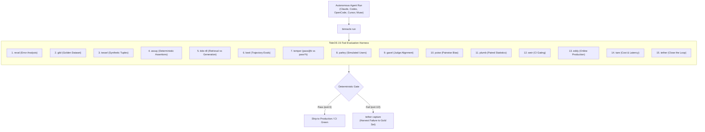

<div align="center">

# binnacle: TideOS Eval Kit (The Evaluator Agent)

**The unified, zero-FFI, pure-Rust evaluator agent orchestrating the complete 15-tool TideOS evaluation stack across autonomous coding agents.**

[](https://github.com/TechTideOhio/binnacle/actions/workflows/ci.yml)
[](https://github.com/TechTideOhio/binnacle/releases/latest)
[](LICENSE)
[](Cargo.toml)
[](Cargo.toml)

[Quickstart](#60-second-quickstart) | [Why binnacle?](#why-binnacle) | [The 15 Checklist Steps](#the-15-evaluation-steps) | [Tool Inventory](#the-complete-tideos-eval-kit) | [Architecture](#architectural-foundations) | [Contributing](CONTRIBUTING.md)

</div>

---

## Why binnacle?

Evaluation is the single most critical and compounding capability in modern AI systems engineering. Prompts are disposable; models are replaced on 90-day cycles; your evaluation harness and ground-truth regression suite are what compound.

In traditional stacks, agent evaluations are fragmented across brittle Python scripts, ad-hoc LangSmith callbacks, non-deterministic model judges, and unverified CI scripts. `binnacle` serves as the compass and helm for agentic evaluation:
- **Zero-FFI, Pure Rust**: Fast sub-second runs, compile-time safety, zero Python runtime dependencies or C library bindings.
- **Fail-Closed Gatekeeper**: Dispatches to dedicated, mathematically bounded evaluation engines (LCS sequence alignment, SimHash deduplication, exact McNemar tests, SplitMix64 bootstrap CIs).
- **Uniform CLI & Envelope Contract**: Standardized JSON envelopes across all 15 stages of evaluation.



---

## The 15 Evaluation Steps

`binnacle` routes directly to the specialized TideOS evaluation tool responsible for each step of production AI engineering:

| # | Step | Tool | Core Engine & Invariants |
|---|---|---|---|
| **1** | **Error Analysis** | `reval` | Open/axial failure coding, causal Bayesian trace DAGs, OTel export. |
| **2** | **Golden Dataset** | `gild` | Stratified ground-truth authoring, schema validation, cryptographic versioning. |
| **3** | **Synthetic Dimensions** | `tessel` | Covering arrays ($P \times I \times C \times E$) with pairwise mathematical coverage guarantees. |
| **4** | **Deterministic Assertions** | `assay` | JSON Schema, JSON Pointer, zero-variance regex, pure-Rust in-memory DB/RLS. |
| **5** | **Retrieval vs Generation** | `tide-rill` | Separate recall@k, MRR, nDCG from context claim lexical support rates and conflict gates. |
| **6** | **Trajectory Evals** | `keel` | Tool-call precision/recall, LCS order alignment, step efficiency, 14 vs 3 step cost bug detection. |
| **7** | **pass@k vs pass^k** | `temper` | Multi-trial capability vs production reliability, real sampling temperature checks. |
| **8** | **Simulated Users** | `parley` | Multi-turn stateful conversational eval, hidden goals, sycophancy resistance. |
| **9** | **Judge Alignment** | `gavel` | Binary classifier calibration, TPR/TNR reporting, Rogan-Gladen prevalence debiasing. |
| **10** | **Pairwise Judge Bias** | `poise` | Order-swapped double-blind adjudication, length-skew normalization. |
| **11** | **Paired Statistics** | `plumb` | SplitMix64 BCa bootstrap CIs, exact McNemar test, TOST equivalence gating. |
| **12** | **CI Gating** | `weir` | Per-category non-compensatory regression prevention in pull requests. |
| **13** | **Online Production** | `eddy` | Deterministic basis-point hash sampling, async judge pools, CUSUM drift detection. |
| **14** | **Cost & Latency** | `tare` | Tokens per request, Cost Per Successful Task (CPST), tail latency (p50/p95/p99) Pareto gates. |
| **15** | **Close the Loop** | `tether` | Secret-scrubbed failure harvesting, SimHash deduplication, fail-closed model release replay. |

---

## Installation

### Option 1: Cargo Install (Recommended for Rust Developers)
```bash
cargo install --git https://github.com/TechTideOhio/binnacle
```

### Option 2: Pre-Built Release Binaries
Pre-compiled standalone binaries for Windows (`x86_64`), macOS (`x86_64`), and Linux (`x86_64`) are available on the [Latest Releases](https://github.com/TechTideOhio/binnacle/releases/latest) page.

#### Windows (PowerShell)
```powershell
Invoke-WebRequest -Uri https://raw.githubusercontent.com/TechTideOhio/binnacle/main/install.ps1 -OutFile install.ps1
powershell -ExecutionPolicy Bypass -File install.ps1
```

#### macOS / Linux (Bash)
```bash
curl -fsSL https://raw.githubusercontent.com/TechTideOhio/binnacle/main/install.sh -o install.sh
bash install.sh
```

### Option 3: Build from Source
```bash
git clone https://github.com/TechTideOhio/binnacle.git
cd binnacle
cargo build --release
# Binary is available at target/release/binnacle
```

---

## 60-Second Quickstart

### Inspect the Evaluation Table
```bash
binnacle table
```

### Healthcheck All 15 Tools
```bash
binnacle doctor
```
> **Tip**: `binnacle doctor` automatically scans local directories, `Tools/<tool>`, `../<tool>`, `~/.cargo/bin`, and your system `PATH`. You can also supply a custom root directory with `--root <path>`.

### Execute a Step or Tool
```bash
# Evaluate an agent trajectory (Step 6 / keel)
binnacle run keel check --suite packs/softfactory.toml --root .

# Evaluate retrieval and faithfulness floors (Step 5 / tide-rill)
binnacle run tide-rill gate examples/synthetic.json examples/thresholds-pass.json

# Check cost-latency Pareto trade-offs (Step 14 / tare)
binnacle run tare table
```

---

## Architectural Foundations

1. **Zero External FFI & Zero Unsafe Code**: Every tool in the evaluation suite compiles under `#![forbid(unsafe_code)]` with zero C-bindings or foreign library dependencies.
2. **Sub-Second Execution**: Deterministic evaluations execute in single-digit milliseconds, allowing entire suites to run locally on pre-commit hooks and in CI.
3. **Decoupled Evaluator Roles**:
   - **Deterministic Systems**: Assertion checkers (`assay`), trajectory alignment (`keel`), and statistical significance (`plumb`) run without LLM API latency or stochastic variance.
   - **Orchestration Plane**: Clean separation of concern where `binnacle` executes as a thin supervisor over dedicated Unix-philosophy CLI binaries.

---

## License

MIT License. Copyright (c) 2026 Alex & TechTide contributors.
